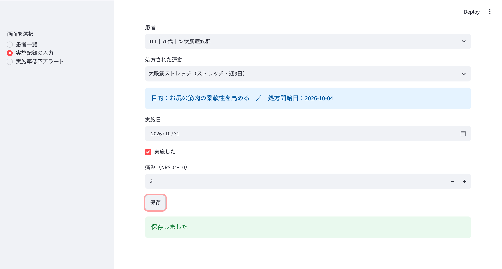
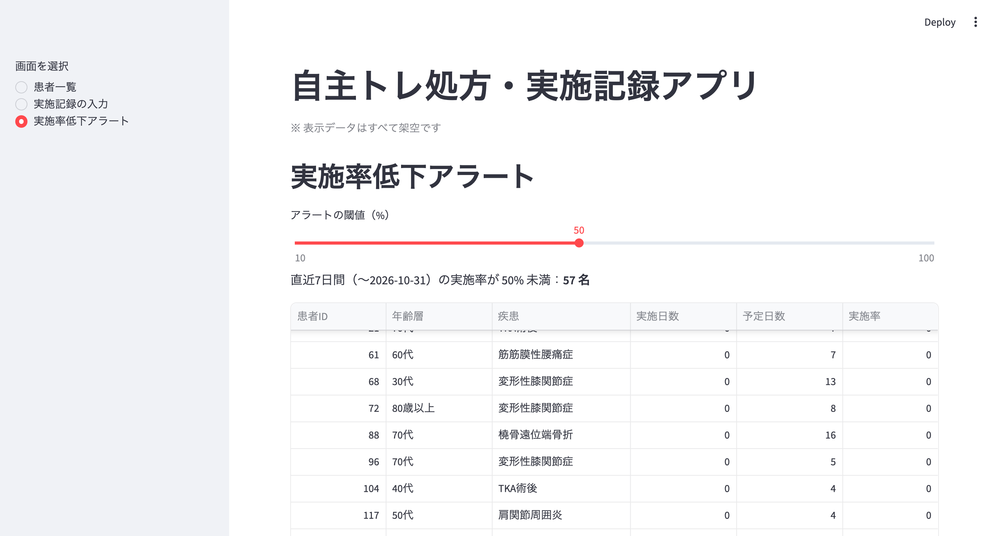

# 自主トレ処方・実施記録アプリ

理学療法士として外来リハビリの現場で感じた課題をもとに、要件定義・設計・実装・テストまでを一人で一巡して作成した、Webアプリのポートフォリオです。

> **データについて**：本リポジトリのデータはすべて**架空**です。実在の患者・医療機関のデータは一切使用していません。サンプルデータは、動作確認のために一定の傾向（高齢ほど実施率が低い、など）を意図的に設定して自動生成しています。そのため、画面に表示される結果は、実際の臨床の傾向を示すものではありません。

## 作った背景

整形外科クリニックの外来リハビリは、1回20分程度の限られた時間で、治療と運動指導の両方を行います。現場では次の課題を感じていました。

- 指導時間が短く、運動の目的や正しい方法が、患者に十分伝わらない
- 自主トレは指導するだけで、自宅で実際に行えているかを把握できない
- 効果を実感できない患者は、来院が途絶えやすい

そこで、自主トレの処方内容と実施状況を記録・可視化し、**実施率が下がった患者を早期に見つけられる**ことを目的に作りました。

## 主な機能

| ID | 機能 | 状況 |
|---|---|---|
| F-01 | 患者の一覧・疾患での絞り込み | 実装済み |
| F-04 | 実施記録の入力（実施の有無、痛みNRS）と入力値チェック | 実装済み |
| F-06 | 実施率低下アラート（直近7日間の実施率が閾値未満の患者を表示。閾値は画面で変更可能） | 実装済み |
| F-02、F-03 | 運動メニュー・処方の登録画面 | 今後（現在はサンプルデータで代替） |
| F-05、F-07 | 実施率の推移グラフ、痛みとの併記グラフ | 今後 |

詳細は[要件定義書](docs/requirements.md)を参照してください。

## 画面


| 実施記録の入力 | 実施率低下アラート |
|---|---|
| |  |

## 使用技術

| 区分 | 技術 |
|---|---|
| 言語 | Python 3.11 |
| 画面 | Streamlit |
| データベース | SQLite |
| データ処理 | pandas |
| テスト | pytest |
| バージョン管理 | Git / GitHub |

## 設計のポイント

- **データベース設計**：運動メニュー（`exercises`）と処方（`prescriptions`）を分け、同じ運動を複数の患者に処方できる構造にしています。詳細は[ER図](docs/er_diagram.md)を参照してください。
- **実施率の定義**：直近7日間の「実施日数 ÷ 処方された週あたり日数」です。記録を付けなくなった患者も検出できるよう、分母は記録の件数ではなく、処方日数にしています。
- **SQL**：処方ごとに集計してから患者単位でまとめる2段階のCTEとし、JOINによる分母の重複を避けています（[`sql/adherence_alert.sql`](sql/adherence_alert.sql)）。
- **入力値チェックの多層化**：画面（スライダーで0〜10に制限）、ロジック（`logic.py`）、データベース（`CHECK`、`UNIQUE`、外部キー）の3段階で守っています。

## ディレクトリ構成

```
.
├── app.py                  # Streamlitアプリ本体
├── logic.py                # 入力値チェック
├── requirements.txt
├── sql/
│   ├── schema.sql          # テーブル定義
│   └── adherence_alert.sql # 実施率低下アラートのSQL
├── scripts/
│   └── generate_data.py    # 架空データの生成
├── tests/                  # pytest
└── docs/
    ├── requirements.md     # 要件定義書
    ├── er_diagram.md       # ER図
    └── test_spec.md        # テスト仕様書
```

## 起動方法

Python 3.11以上が必要です。プロジェクトのフォルダで、次を実行します。

```bash
# 1. 仮想環境の作成と、ライブラリのインストール
python3 -m venv .venv
source .venv/bin/activate
pip install -r requirements.txt

# 2. データベースの作成と、架空データの生成
sqlite3 app.db < sql/schema.sql
python scripts/generate_data.py

# 3. アプリの起動
streamlit run app.py
```

ブラウザが開き、アプリが表示されます。やり直す場合は `app.db` を削除してから、手順2を実行してください（再実行するとデータが二重に入ります）。

## テスト

```bash
python -m pytest -v
```

入力値チェックの境界値テスト、データベース制約のテストなど、10件の自動テストがあります。テストの内容は[テスト仕様書](docs/test_spec.md)にまとめています。

## 既知の制約・今後の課題

- ログイン認証、スマートフォン対応、電子カルテとの連携は、スコープ外としています。
- 実施率低下アラートの基準日は、サンプルデータの最終日（2026-10-31）に固定しています。実運用では、当日の日付を使います。
- 画面を操作するテストは手動です。今後、自動化を検討しています。
- 実施率の推移グラフ（F-05）、痛みとの併記グラフ（F-07）を、順次追加する予定です。

## 作者

（氏名またはハンドルネーム）／ 理学療法士
